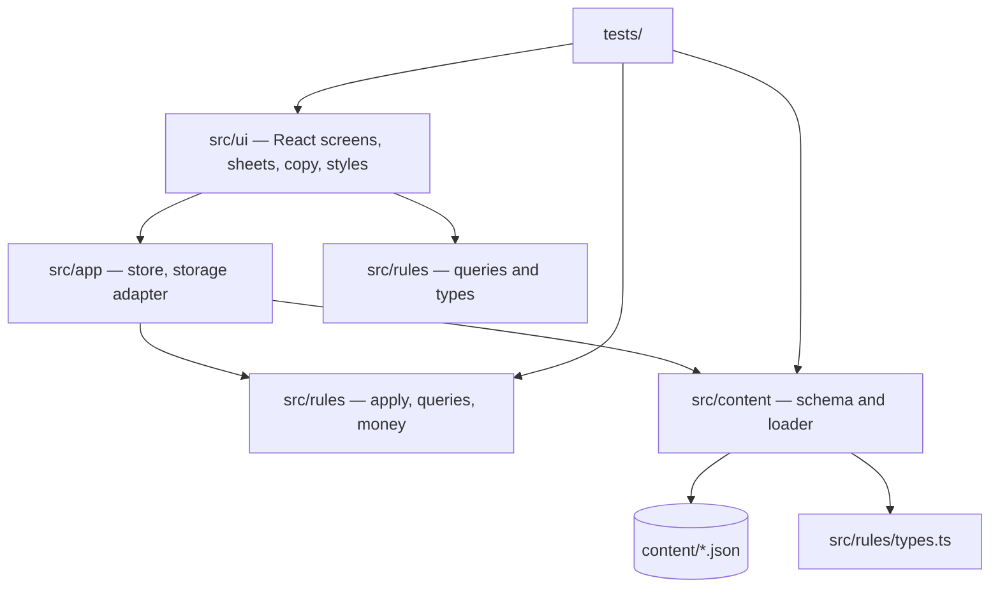
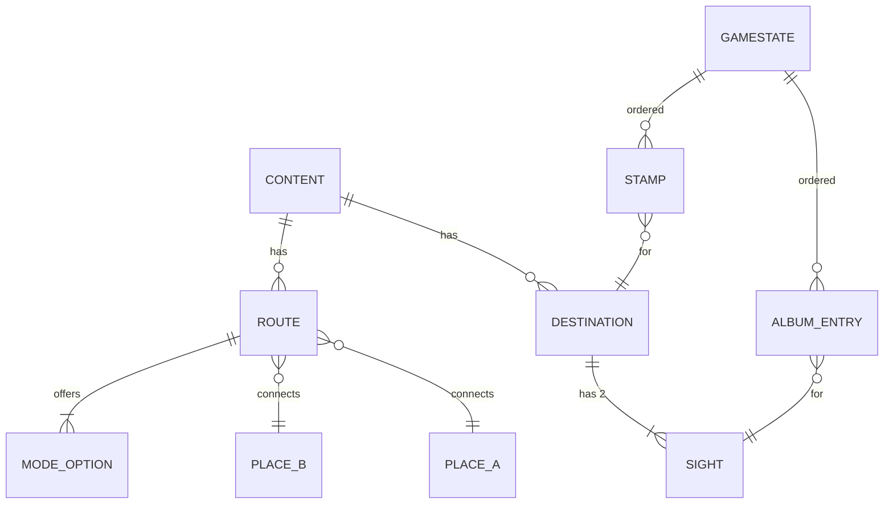
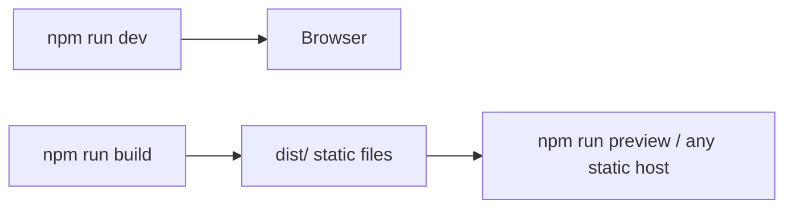

# Architecture Spine — WORLDBOUND: NOMAD

> **Note on `../technology.md`:** that file describes the instructor's own project (Pytagoras Forlag website v2). It is an external reference, not Worldbound's architecture, and nothing in it binds this project. This spine is the architecture for Worldbound.

## Design Paradigm

**Functional core, imperative shell.** All game rules are pure TypeScript functions over an immutable `GameState`. The React UI is a thin shell. It renders state, keeps draft and presentational state, and sends committed actions to the rules. Content (destinations, routes, sights, facts) is data. It is passed into the rules and never imported by them.

| Layer | Directory | May depend on |
| --- | --- | --- |
| Content data | `content/*.json` | — |
| Content schema and loader | `src/content/` | zod, `src/rules/types.ts` |
| Rules (functional core) | `src/rules/` | nothing outside `src/rules/` |
| App shell (store, storage) | `src/app/` | `src/rules/`, `src/content/` |
| UI | `src/ui/` | `src/app/`, `src/rules/` (types and queries only), React |



## Invariants & Rules

### AD-1 — Rules are pure and isolated
- **Binds:** NFR-1, NFR-2, all rule FRs (FR-1, FR-4, FR-6 – FR-18, FR-21 – FR-23)
- **Prevents:** rule logic leaking into components, or rules that cannot run without a browser
- **Rule:** `src/rules/` imports nothing from React, the DOM, `window`, storage, `src/app/` or `src/ui/`. It never calls `Date.now()`, `Math.random()` or reads globals. An ESLint `no-restricted-imports` rule on `src/rules/**` enforces this.

### AD-2 — One mutation path: `apply`
- **Binds:** all committed actions (EXPERIENCE → State Model, commit table)
- **Prevents:** two components changing money or days in different ways
- **Rule:** game state changes only through `apply(state, action, content): Result`. `Result` is either `{ ok: true, state }` or `{ ok: false, reason }`. The actions are a closed union: `startJourney`, `travel`, `spendCityDay`, `callHome`, and [EXT] `startShift` · `answer` · `finishShift`. `apply` returns a new state and never mutates its input. A rejected action leaves state unchanged (FR-6, FR-9). After every successful action, `apply` evaluates the end rules itself (arriving home, FR-7, FR-12, FR-13) and sets `outcome` and `failReason`. There is no separate "end journey" action, and the UI never decides that a journey has ended. Once `outcome` is set, every action except `startJourney` is rejected with `JOURNEY_ENDED`.

### AD-3 — The UI reads queries, never computes rules
- **Binds:** FR-4, FR-9, FR-12, FR-13, FR-21; EXPERIENCE "Queries the UI reads and never computes"
- **Prevents:** a screen showing "available" while `apply` rejects the action
- **Rule:** availability, reasons, home-unreachable warnings, call home offered, journey ended (outcome + reason) and the cost totals in the city day draft come from pure query functions in `src/rules/queries.ts`. A query and the matching `apply` share the same internal check function.

### AD-4 — Reasons are a closed set of codes
- **Binds:** FR-4, FR-9, FR-15, FR-21; copy in `src/ui/copy.ts`
- **Prevents:** free-text errors that tests and copy cannot match
- **Rule:** every rejection and unavailability carries a `ReasonCode` from one union in `src/rules/types.ts` (e.g. `NOT_ENOUGH_MONEY`, `NOT_ENOUGH_DAYS`, `NO_ROUTE`, `AT_HOME`, `ALREADY_IN_ALBUM`, `JOURNEY_ENDED`). The UI maps codes to copy, and tests assert codes, never strings.

### AD-5 — Money and days are integers; one pricing function
- **Binds:** FR-6, FR-8, FR-17, FR-21, Decision E (halves round up)
- **Prevents:** float drift and two different roundings of accommodation prices
- **Rule:** money is whole euros and days are whole days, both `number` integers. The accommodation price is computed only by `accommodationPrice()` in `src/rules/money.ts` (`Math.floor(x + 0.5)` on the product). No other module multiplies a cost factor.

### AD-6 — The city day is one atomic action in a fixed order
- **Binds:** FR-8, FR-10, FR-21, FR-22, FR-23, Decisions F and G
- **Prevents:** sights paid before the stay, stamps given without a city day, or partial days
- **Rule:** `spendCityDay({ sightIds, ending })` applies (1) accommodation (none if `ending` is a night departure), +1 day, stamp if first city day; (2) sights in order from the remaining money; a sight already in the album is rejected with `ALREADY_IN_ALBUM` (viewing it again is UI only); (3) [EXT] night departure travel. If any step fails, the whole action is rejected.

### AD-7 — Content is passed in, validated, and keyed by stable ids
- **Binds:** NFR-7, NFR-8, FR-3, FR-5, FR-19, FR-21
- **Prevents:** rules that only work with the real content, or ids that drift between files
- **Rule:** content is JSON in `/content`, validated by zod schemas in `src/content/schema.ts` at load and in a test. Ids are lowercase kebab (`copenhagen`, `copenhagen-tivoli`). `home` is the fixed id for Bergen. Every sight and photo record carries `source`, `author` and `licence`. Rules take a `Content` object as an argument, so tests use small fixtures from `tests/fixtures/`.

### AD-8 — Persistence goes through one storage adapter
- **Binds:** FR-2, FR-20, FR-24, NFR-9; EXPERIENCE Foundation → Persistence
- **Prevents:** scattered `localStorage` calls that crash when storage is blocked
- **Rule:** only `src/app/storage.ts` touches browser storage, with every access in try/catch and a working in-memory fallback. Core stores only the intro flag and the last traveller name. [EXT] The saved journey is `{ schemaVersion, state }`. An unreadable or mismatched save is discarded with a message (FR-20).

### AD-9 — Copy and tokens live in one place each
- **Binds:** NFR-5, NFR-6; DESIGN.md tokens; EXPERIENCE Copy templates
- **Prevents:** hard-coded strings and colours that drift from the UX spec
- **Rule:** all player-facing text comes from template functions in `src/ui/copy.ts`, with names following the EXPERIENCE copy keys (e.g. `cityday`, `end.stranded`). All colours, spacing and type sizes come from CSS custom properties in `src/ui/styles/tokens.css` (light + dark), mirroring the DESIGN.md tokens. Components use CSS Modules and no UI kit.

### AD-10 — Tests are traceable to requirements
- **Binds:** SM-1, SM-2, SM-3, SM-5, NFR-2
- **Prevents:** test suites that cannot show which requirement they prove
- **Rule:** each rules test `describe` block starts with its FR id (`describe('FR-8 city day', …)`). UJ-1 and UJ-2 are scripted rules tests and Playwright e2e tests on a 375 × 812 viewport. SM-3 is an automated balance test over the real content. A pull request names its story id and the FR ids it covers.

## Consistency Conventions

| Concern | Convention |
| --- | --- |
| Language | English in code, identifiers, comments, content and UI (NFR-6). Commit messages and logs may be Norwegian. |
| Naming | Files `camelCase.ts`; React components `PascalCase.tsx`, one per file; action types `camelCase` verbs; content ids lowercase kebab; transport modes `'plane' \| 'train' \| 'bus'`. |
| Glossary | Type and function names use PRD glossary terms: `journey`, `cityDay`, `stamp`, `callHome`, `photoAlbum`, `daysUsed`. Never synonyms such as "trip", "visit", "points". |
| Days | State stores `daysUsed`. "Day X of N" is derived (X = daysUsed + 1, capped). `daysRemaining = modeDays − daysUsed`. |
| Ordering | Stamps and album entries are ordered arrays of `{ id, day }`. "Most recently earned stamp" = last element (FR-12). |
| Formatting | Prettier defaults; ESLint recommended + typescript-eslint; `strict: true` in tsconfig. |
| Errors | Rules never throw for player actions. A thrown error means a bug or invalid content and is caught by a top-level React error boundary. |

## Stack

| Name | Version |
| --- | --- |
| Node.js (dev only) | ≥ 22.12 (tested with 26.8.1) |
| TypeScript | 6.0.x (not 7: typescript-eslint supports < 6.1) |
| Vite | 8.3 |
| React / React DOM | 19.3 |
| @vitejs/plugin-react | 6.3 |
| zod | 4.6 |
| Vitest | 5.1 |
| @testing-library/react | 16.3 |
| Playwright (@playwright/test) | 1.65 |
| ESLint / typescript-eslint / Prettier | 10.14 / 8.72 / 3.10 |

Versions were checked against the npm registry on 2026-11-13.

## Structural Seed

```text
/                      # repo root = app root
  content/             # game data (NFR-7): config.json, destinations.json, routes.json, sights.json; [EXT] questions/*.json
  public/assets/       # sights/, streets/, map/, brand/, icons/ ([EXT] sounds/) — paths per EXPERIENCE → Content Assets
  src/
    rules/             # functional core: types.ts, apply.ts, queries.ts, money.ts, travel.ts, cityDay.ts, callHome.ts, end.ts
    content/           # schema.ts (zod), load.ts
    app/               # store.ts (useReducer around apply), storage.ts
    ui/                # screens/, sheets/, components/, copy.ts, styles/tokens.css
    main.tsx
  tests/
    rules/             # one file per FR group, FR ids in describe()
    content/           # schema validation of real content
    balance/           # SM-3
    ui/                # component tests (Testing Library)
    e2e/               # Playwright: UJ-1, UJ-2 at 375 px
    fixtures/          # small content sets and fixed game states
  .docs/               # planning artifacts (BMAD), process docs
  .logs/               # session logs
```



`GameState` fields follow EXPERIENCE → State Model: mode, travellerName, position, money, daysUsed, stamps, album, per-destination city-day count, calledHome, outcome and failReason, plus [EXT] tier and night flag per destination and the question index.



## Capability → Architecture Map

| Capability / Area | Lives in | Governed by |
| --- | --- | --- |
| FR-1 start, FR-2 intro | `rules/apply.ts` (startJourney), `ui/screens/Start`, `app/storage.ts` | AD-2, AD-8 |
| FR-3 map, FR-5 fact card | `ui/screens/Map`, `ui/sheets/Arrival`, `content/destinations.json` | AD-7, AD-9 |
| FR-4 routes, warnings | `rules/queries.ts`, `rules/travel.ts`, `ui/sheets/RouteSheet` | AD-3, AD-4 |
| FR-6, FR-7 travel | `rules/travel.ts` | AD-2, AD-5 |
| FR-8, FR-10, FR-21, FR-22 city day, stamps, sights, album | `rules/cityDay.ts`, `ui/screens/CityDay`, `ui/screens/DayComplete` | AD-5, AD-6 |
| FR-9 money ≥ 0 | all `apply` paths | AD-2, AD-4 |
| FR-11, FR-13, FR-14 goal, end, summary | `rules/end.ts`, `ui/screens/Summary`, `ui/sheets/CantContinue` | AD-3 |
| FR-12 call home | `rules/callHome.ts`, `ui/sheets/CallHome` | AD-2, AD-3 |
| [EXT] FR-15 – FR-20, FR-23, FR-24 | new rules modules + content files, same pattern | AD-1 – AD-8 |
| SM-1, SM-3 | `tests/rules`, `tests/balance` | AD-10 |

## Deferred

- **Hosting:** the README run path is local (`npm run dev`), which is all NFR-3 requires. Publishing on GitHub Pages is optional and can be added in the final week.
- **CI:** no GitHub Actions in the plan. Tests are run locally and reported in PRs. Add CI only if time allows.
- **[EXT] save schema migration:** v1 discards any save whose `schemaVersion` differs. Migrations wait until there is a second version.
- **[EXT] sound file format:** chosen when FR-24 starts.
- **AI travel assistant:** fully deferred (PRD OQ4). If it is added, it must follow NFR-3 (optional, mock in tests) and sits outside `src/rules/`.
- **Visual details** (map drawing, illustrations, logo vector): owned by DESIGN.md and EXPERIENCE.md, not by this spine.
