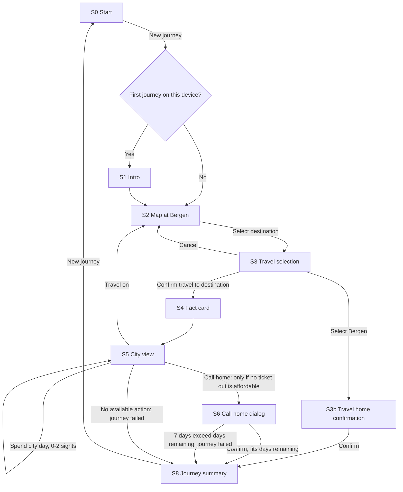

# UX Specification: WORLDBOUND: NOMAD — Task 1

## 1. Purpose and Scope

This document defines the low-fidelity UX for the MVP core on a mobile phone: the world map, the destination/city view, travel selection, and the time, money, and stamp indicators. It is the first UX task named in the PRD (§7): "sketches of the two key mobile screens: the map (choose destination and route) and the city day (accommodation, sights, travel on)."

**In scope (Task 1):**
- Mobile-first layout at 375 px width (PRD NFR-4)
- World map as a schematic route map
- Destination/city view, including the city day and sights
- Travel selection, including unavailable options and warnings
- Status indicators for time, money, and stamps
- Screen inventory and user flow for the whole MVP core, so later tasks fit around Task 1

**Out of scope (Task 1):**
- Detailed design of the intro, fact card, photo album, call home dialog, and journey summary — listed in the screen inventory, designed in UX Task 2
- All MVP extension screens: work/shift quiz, accommodation tiers, night departures, Nomad mode, save and resume
- Visual identity, logo, colors, typography, illustrations, and icons — wireframes here are structural only
- Any application code or technology choice (Architecture)

**Status:** draft for human review. Nothing here is a decision until approved by the team. Items needing a human decision are listed in §9.

### 1.1 Status of design choices

This spec introduces no new game rules: every rule it shows comes from the PRD at `c79994a`. Interface choices have two different statuses:

- **Human decisions (Thomas Rothe, 2026-10-13):** the schematic route map (§7.1); English; sight timing and the Bergen transfer point left open (§9).
- **AI proposals, pending team review:** the destination list view (S2b); travel selection as a bottom sheet; travel as two steps (select, then confirm); the after-action preview (§6.2); the status bar on every in-journey screen rather than only on the map (§6.1); change feedback (§6.3); and every item marked "proposal" elsewhere in this document. These are the AI's suggested answers to the PRD requirements, not approved design.

## 2. Source References

`main` does not yet contain the revised brief or the PRD. This specification is based on the versions below, cited by commit so it stays traceable even if those documents change before they are merged.

| Source | Branch | Commit | Path |
|---|---|---|---|
| Revised Product Brief | `origin/revider-product-brief` (PR #1, open) | `900e337` | `.docs/planning-artifacts/briefs/brief-worldbound-nomad-2026-09-15/brief.md` |
| PRD (status: final) | `origin/prd-worldbound-nomad` | `c79994a` | `.docs/planning-artifacts/prds/prd-worldbound-nomad-2026-10-12/prd.md` |
| PRD addendum (values, routes, sights, UI strings) | `origin/prd-worldbound-nomad` | `c79994a` | `.docs/planning-artifacts/prds/prd-worldbound-nomad-2026-10-12/addendum.md` |
| Original Product Brief and addendum | `main` | `04f5378` | `.docs/planning-artifacts/briefs/brief-worldbound-nomad-2026-09-15/` |
| Instructor feedback (2026-10-06) | `main` | `04f5378` | `.docs/planning-artifacts/briefs/brief-worldbound-nomad-2026-09-15/tilbakemelding-product-brief.md` |

All game values in the wireframes — route prices and days, accommodation prices, sights and ticket prices — come from the PRD addendum at `c79994a` and are proposals to be confirmed by the balance test. The UJ-1 example state (Day 6, €1,270; Day 7, €1,153) is calculated from those values. Player states in the edge-case examples (e.g. €450 in Istanbul, €30 short, 2 or 3 days left) are hypothetical, chosen only to show each state. Terms follow the PRD glossary (§3); UI strings follow addendum §7.

If the PRD changes before merge, this document must be re-checked against the new commit.

## 3. Mobile-First Design Principles

1. **Phone first, portrait first.** Every screen is designed at 375 × 667 px (a small phone) in portrait. A full journey must be playable at 375 px without horizontal scrolling (NFR-4). Tablet and PC get the same structure with more room (§3.1), not a separate design.
2. **Short sessions.** The primary player plays in short gaps, such as a bus ride (PRD §2.2). Each screen answers one question: *where can I go?* (map), *what do I do here?* (city view), *how do I get there?* (travel selection).
3. **Thumb zone for actions.** Primary actions sit in the lower half of the screen, full-width. Information sits at the top; decisions sit at the bottom.
4. **Status always visible.** Day counter, days remaining, money, and stamps stay on screen during a journey (FR-3; §6).
5. **Consequence before commitment.** Every action that costs money, days, or a stamp states the cost and the resulting state before the player confirms (PRD §7: "Consequences are stated plainly before the player commits").
6. **Show, don't hide, what is unavailable.** Unaffordable or too-long options stay visible with a reason (FR-4, FR-9), so the player learns the rules from the interface.
7. **Calm, not pressured.** No countdown timers, no animations that suggest urgency, no casino-style rewards (PRD §7 anti-references). Scarcity is shown with plain numbers and words.
8. **Rules live outside the UI.** All numbers shown — prices, previews, availability, warnings — come from the game rules, not from screen logic (NFR-2). The UX only presents them.

### 3.1 Larger screens (proposal)

- **Tablet and PC (≥ 768 px wide):** map on the left, the current panel (city view or travel selection) on the right instead of as a bottom sheet. Status bar stays at the top.
- No feature exists only on larger screens.

## 4. Screen Inventory

Screens marked **Task 1** are specified in this document. The others are listed so the flow is complete and are designed in Task 2.

| ID | Screen | Type | Purpose | PRD | Task |
|---|---|---|---|---|---|
| S0 | Start | Full screen | Title, "New journey" | FR-1 | 2 |
| S1 | Intro | Full screen | Goal (5 stamps, home within 30 days), €1,500, 30 days; first time only, reopenable from menu | FR-2 | 2 |
| S2 | Map | Full screen | Main screen: places, position, stamps, reachability, status | FR-3, FR-4 | **1** |
| S2b | Destination list | Full screen (alternative view of S2) | Same content as the map as an accessible list | FR-3, FR-4, NFR-5 | **1** |
| S3 | Travel selection | Bottom sheet over S2 | Transport modes for one route, previews, warnings, confirm | FR-4, FR-6, FR-7 | **1** |
| S3b | Travel home confirmation | Dialog | Stamp count, goal reached or not, confirm ends journey | FR-7, FR-11 | **1** (structure), 2 (detail) |
| S4 | Fact card | Sheet / dialog | 2–3 sentences on arrival; reopenable | FR-5 | 2 |
| S5 | City view | Full screen | Accommodation, sights, stamp status, actions | FR-8, FR-9, FR-10, FR-12, FR-21 | **1** |
| S6 | Call home dialog | Dialog | Cost: 7 days and one stamp; or "cannot get home in time" | FR-12, FR-13 | 2 |
| S7 | Photo album | Full screen | Visited sights with photo and fact | FR-22 | 2 |
| S8 | Journey summary | Full screen | Stamps, album, days used, money left, goal result, "Called home" | FR-11, FR-13, FR-14 | 2 |
| S9 | Menu | Sheet | Intro, photo album, fact card, new journey | FR-2, FR-5, FR-22 | 2 |

**Persistent element:** the status bar (§6) appears on S2, S2b, S3, S5, S7 during a journey.

## 5. User Flow (MVP core)



**Main path (from PRD UJ-1):** Start → Intro → Map (Bergen) → choose Copenhagen → choose Bus → fact card → city view → spend city day (stamp 1) → map → … → choose Bergen → confirm → summary "Goal reached".

**Flow rules taken from the PRD:**
- Arrival at a destination shows its fact card (FR-5), then the city view.
- A city day is an explicit action; the player may spend several city days at the same destination (UJ-2). Only the first gives a stamp (FR-10).
- The player may travel on without spending a city day, but then earns no stamp there (FR-10).
- Arriving in Bergen always ends the journey (FR-7; see open question OQ-UX-2).
- Call home is only offered when no ticket out of the current destination is affordable (FR-12).
- The journey also ends, as failed, when no action is available (FR-13).

## 6. Time, Money, and Stamp Indicators

### 6.1 Status bar

A two-line bar fixed to the top of every in-journey screen (proposal; FR-3 requires it on the map screen only).

```
┌───────────────────────────────────┐
│ Day 7 of 30          24 days left │
│ €1,153               Stamps 2 / 5 │
└───────────────────────────────────┘
```

| Indicator | Format | Rule source |
|---|---|---|
| Day counter | `Day X of 30` — X = days used + 1, capped at 30 | Glossary "Day counter"; addendum §7 |
| Days remaining | `N days left` (`1 day left` when singular) | Glossary "Days remaining"; FR-3 |
| Money | `€1,153` — whole euros, comma thousands separator | Glossary "Money"; FR-9 |
| Stamps | `Stamps N / 5` — the goal is shown, not only the count | FR-3, FR-10, FR-11 |

- Each indicator has a text label or unit; none relies on an icon or color alone (NFR-5).
- Tapping the stamp indicator opens the collected stamps with destination names (proposal).

### 6.2 After-action preview (proposal)

Wherever an action costs money or days, the option shows the state after it, in the same format as the status bar:

```
After: €1,063 · Day 8 of 30
```

This is the main tool for making the time-versus-money trade-off visible. It supports PRD §9.3: in the MVP core, money binds and time is roomy, so the UX should still make each day's cost visible without adding pressure.

### 6.3 Change feedback (proposal)

After an action, the status bar shows the change next to the new value for a short moment, e.g. `€1,153 (−€117)` and `Day 7 of 30 (+1)`. The change is text, not only motion or color, and it respects the device's reduced-motion setting.

### 6.4 Low-resource states (proposal — thresholds are an open question)

| State | Proposed trigger | Shown as |
|---|---|---|
| Money low | Money is below the cheapest ticket out of the current position plus one city day there | Text label "Low money" next to the money value, plus an icon |
| Home at risk | Days remaining are fewer than the shortest route home in days plus a small margin | Text label "Plan your way home" next to days left, plus an icon |
| Goal unreachable by days | The FR-4 warning: after an option, home can no longer be reached in time | Warning on the travel option itself (§7.3) |

Exact triggers are open (OQ-UX-4). Only the FR-4 warning is required by the PRD.

## 7. Low-Fidelity Wireframes

Wireframes show structure and content, not visual style. Width ≈ 375 px. Example state follows PRD UJ-1: the player has spent a city day in Copenhagen and in Paris and is now in Paris on Day 7 with €1,153 and 2 stamps.

### 7.1 Map (S2)

The map is a schematic route map (human decision, 2026-10-13): places are positioned for legibility and tap size, not geographic accuracy. Europe is enlarged in the middle; New York sits to the west, Tokyo and Sydney to the east. Routes are drawn as lines between places; routes from the current position are emphasized and all other routes are faint.

```
┌───────────────────────────────────┐
│ Day 7 of 30          24 days left │
│ €1,153               Stamps 2 / 5 │
├───────────────────────────────────┤
│              [⌂ Bergen ▸]         │
│                                   │
│                   [✓ Copenhagen ▸]│
│ [New York ▸]  [London ▸]          │
│                                   │
│          (● ✓ Paris)              │
│                       [Rome ▸]    │
│                                   │
│                    [Istanbul]     │
│                                   │
│                [Tokyo]   [Sydney] │
│                                   │
├───────────────────────────────────┤
│ ● You are here   ✓ Stamp  ⌂ Home  │
│ ▸ Route from here                 │
│ [ List view ]          [ ≡ Menu ] │
└───────────────────────────────────┘
```

Route lines are omitted in the sketch; `▸` marks places with a route from the current position (from Paris: Bergen, Copenhagen, London, Rome, New York — addendum §4).

**Behavior:**
- Tap a place with `▸` → opens travel selection (S3) for that route.
- Tap a place without a route from here → short message: "No direct route from Paris. Travel via another city." It cannot be selected as a travel target (FR-4).
- Tap the current position → opens the city view (S5).
- Bergen is marked as Home with its own symbol and the label "Home", never as a destination (glossary "Home").
- Every place label is at least a 44 × 44 px tap target (NFR-5). The schematic layout exists to guarantee this for the six places in Europe.
- Stamped places show `✓` and are read out as "stamped" — not shown by color alone (FR-3).
- "List view" switches to S2b.

**Destination list (S2b)** — the same information as rows, for accessibility, very small screens, and players who prefer lists:

```
┌───────────────────────────────────┐
│ Day 7 of 30          24 days left │
│ €1,153               Stamps 2 / 5 │
├───────────────────────────────────┤
│ You are in: Paris  ✓ stamped      │
│                                   │
│ Routes from here                  │
│ ⌂ Bergen (Home)    Plane      ▸   │
│ ✓ Copenhagen       Pl·Tr·Bus  ▸   │
│   London           Pl·Tr·Bus  ▸   │
│   Rome             Pl·Tr·Bus  ▸   │
│   New York         Plane      ▸   │
│                                   │
│ No route from here                │
│   Istanbul · Tokyo · Sydney       │
│                                   │
│ [ Map view ]           [ ≡ Menu ] │
└───────────────────────────────────┘
```

### 7.2 City view (S5)

**Default state** — arriving in Paris for the first time (Day 6, €1,270, 1 stamp), before the city day. The timing of sight selection is an open question (OQ-UX-1), so two variants are sketched.

**Variant A — choose sights before confirming the city day (one combined action):**

```
┌───────────────────────────────────┐
│ Day 6 of 30          25 days left │
│ €1,270               Stamps 1 / 5 │
├───────────────────────────────────┤
│ PARIS                  [ Fact ⓘ ] │
│ First city day here earns a stamp │
│                                   │
│ City day                          │
│ Accommodation        €80 · 1 day  │
│                                   │
│ Sights (optional)                 │
│ [ ] Eiffel Tower            €20   │
│ [ ] Louvre                  €17   │
│                                   │
│ Total €80                         │
│ After: €1,190 · Day 7 of 30       │
│ ┌───────────────────────────────┐ │
│ │    Spend city day — €80       │ │
│ └───────────────────────────────┘ │
│ [ Travel on ]                     │
└───────────────────────────────────┘
```

Ticking sights updates the total and the after-preview (both sights: total €117, after €1,153 · Day 7 of 30).

**Variant B — start the city day first, then visit sights during it:**

```
┌───────────────────────────────────┐
│ Day 7 of 30          24 days left │
│ €1,190               Stamps 2 / 5 │
├───────────────────────────────────┤
│ PARIS  ✓ Stamp earned  [ Fact ⓘ ] │
│ City day in progress              │
│                                   │
│ Sights today (optional)           │
│ Eiffel Tower  €20     [ Visit ]   │
│ Louvre        €17     [ Visit ]   │
│                                   │
│ ┌───────────────────────────────┐ │
│ │        Travel on              │ │
│ └───────────────────────────────┘ │
│ [ Spend another city day — €80 ]  │
└───────────────────────────────────┘
```

| | Variant A | Variant B |
|---|---|---|
| Matches FR-21 ("as part of a city day") | Yes | Yes |
| Taps per city day | Fewer: one confirm | More: confirm, then each sight |
| Clarity of total cost | Total shown before commit | Accommodation first, sights after |
| Sight unavailable rule (FR-21: money after accommodation below ticket) | Checked as sights are ticked | Checked naturally after accommodation is paid |
| Fits a "day in the city" feeling | Weaker | Stronger |

Decision deferred to Christian (OQ-UX-1).

**State: city day not affordable** (FR-8, FR-9):

```
│ City day                          │
│ Accommodation        €80 · 1 day  │
│ ⚠ Not enough money (€30 short)    │
│ [ Spend city day ]   (disabled)   │
│ ┌───────────────────────────────┐ │
│ │        Travel on              │ │
│ └───────────────────────────────┘ │
```

**State: no ticket out is affordable — call home offered** (FR-12):

```
│ ⚠ You can't afford any ticket     │
│   out of Rome.                    │
│ ┌───────────────────────────────┐ │
│ │ Call home                     │ │
│ │ Costs 7 days and one stamp    │ │
│ └───────────────────────────────┘ │
```

"Call home" opens the call home dialog (S6, Task 2), which shows the cost again and asks for confirmation. It is never shown when any ticket out is affordable. The cost text "one stamp" assumes the player has a stamp; FR-12 removes a stamp only if the player has any, so the wording for a player with 0 stamps is defined with S6 in UX Task 2.

**State: revisit or later city day.** The stamp line reads "Stamp already earned here"; sights already visited are shown as "In your album" and are not offered again (FR-22 assumption).

### 7.3 Travel selection (S3)

A bottom sheet over the dimmed map. Example: from Paris to Rome (addendum §4: plane €150 · 1 d, train €90 · 1 d, bus €50 · 2 d), Day 7, €1,153.

```
┌───────────────────────────────────┐
│ Day 7 of 30          24 days left │
│ €1,153               Stamps 2 / 5 │
├───────────────────────────────────┤
│ (map, dimmed)                     │
├───────────────────────────────────┤
│ Paris → Rome                [ ✕ ] │
│                                   │
│ ( ) Plane     €150 · 1 day        │
│     After: €1,003 · Day 8 of 30   │
│ (•) Train      €90 · 1 day        │
│     After: €1,063 · Day 8 of 30   │
│ ( ) Bus        €50 · 2 days       │
│     After: €1,103 · Day 9 of 30   │
│                                   │
│ ┌───────────────────────────────┐ │
│ │  Travel by train — €90, 1 day │ │
│ └───────────────────────────────┘ │
└───────────────────────────────────┘
```

**Behavior:**
- Selecting a transport mode is a separate step from confirming; the confirm button repeats the choice and its cost (principle 5).
- Each transport mode is a full-width row ≥ 44 px tall with a text label (Plane / Train / Bus — addendum §7) and an icon; the mode is never identified by icon alone.
- No transport mode is pre-selected by the game in a way that favors spending (proposal: nothing selected until the player taps).
- Close (`✕`), tapping outside, or the back gesture returns to the map without changes.

**States** (shown as single rows):

```
│ ( ) Plane     €600 · 2 days       │   Istanbul → Sydney, €450
│    ⚠ Not enough money (€150 short)│  (unavailable, FR-4)
```

```
│ ( ) Bus        €80 · 3 days       │   Rome → Istanbul, 2 days left
│     ⚠ Not enough days             │  (unavailable, FR-4)
```

```
│ ( ) Bus        €80 · 3 days       │   Rome → Istanbul, 3 days left:
│     After: €620 · Day 30 of 30    │   available, but no days remain
│     ⚠ You can't make it home in   │   to get home afterwards
│       time from Istanbul.         │  (warning, not blocked — FR-4)
```

```
│ ⚠ You haven't spent a city day in │   leaving a destination
│   Paris — you leave without its   │   without a stamp (proposal,
│   stamp.                          │   OQ-UX-3; consequence of FR-10)
```

**Travel home (S3b)** — selecting Bergen opens a confirmation instead of a plain confirm (FR-7):

```
┌───────────────────────────────────┐
│ Go home to Bergen?                │
│                                   │
│ This ends your journey.           │
│ Stamps: 5 / 5 — Goal reached      │
│ (or: Stamps: 3 / 5 —              │
│  Goal not reached)                │
│                                   │
│ Plane   €180 · 1 day              │
│                                   │
│ [ Stay on the road ]              │
│ ┌───────────────────────────────┐ │
│ │      Go home — €180           │ │
│ └───────────────────────────────┘ │
└───────────────────────────────────┘
```

The sketch shows the route from Paris, which has only a plane. When the route home has more than one transport mode (Bergen – Copenhagen: plane, train, bus — addendum §4), S3b lists each mode with its price, days, and after-preview, as in S3, and the confirm button names the chosen mode.

Under the current PRD, Bergen cannot be used as a transfer point: arriving there always ends the journey. This dialog makes that explicit. Whether this behavior is intended is unresolved (OQ-UX-2).

## 8. Accessibility Considerations

Based on PRD NFR-5 ("readable text on mobile, touch targets of at least 44 × 44 px, and information never conveyed by color alone. No formal WCAG certification"). Items beyond NFR-5 are proposals and marked as such.

- **Touch targets:** every tappable element ≥ 44 × 44 px, including map places, transport rows, sight checkboxes, and close buttons (NFR-5).
- **No color alone:** stamps (`✓`), current position (`●`), home (`⌂`), reachability (`▸`), unavailable options, and warnings (`⚠` plus text) all have a non-color cue (NFR-5, FR-3).
- **Reasons in words:** every unavailable action states why in plain text (FR-4, FR-9).
- **Readable text (proposal):** body text at least 16 px; no essential text in images.
- **Contrast (proposal):** aim for WCAG 2.2 AA contrast (4.5:1 for body text) as a design target, without formal certification.
- **Map alternative:** the destination list (S2b) offers the full map content and all travel actions without needing to read the map visually.
- **Screen readers (proposal):** each map place has an accessible name such as "Rome, route from here" or "Copenhagen, stamped"; status bar values are announced when they change; the page language is English (NFR-6).
- **Keyboard (PC, proposal):** all actions reachable by keyboard with visible focus; the bottom sheet traps focus while open and returns it to the selected place on close.
- **Motion (proposal):** no essential information in animation; respect the reduced-motion setting.
- **No time pressure:** no real-time timers; the player can pause between any two actions indefinitely (PRD §7).

## 9. Open Questions Requiring Human Decisions

| ID | Question | Options | Owner | Status |
|---|---|---|---|---|
| OQ-UX-1 | When does the player choose sights: before confirming the city day (Variant A) or during it (Variant B)? | A: one combined action, total cost shown up front. B: city day first, then sights one at a time. See §7.2. | Christian | Open — deferred by Thomas, 2026-10-13 |
| OQ-UX-2 | Should Bergen work as a transfer point? Under the current PRD (FR-7), arriving in Bergen always ends the journey, so a player cannot pass through home to reach another destination. All far destinations are also reachable without Bergen (New York via London or Paris; Tokyo via Istanbul or New York; Sydney via Istanbul or Tokyo — addendum §4). | Keep PRD behavior (confirmation dialog S3b makes it explicit) or change the PRD to allow transit. | Thomas and Christian | Unresolved — this spec follows the current PRD |
| OQ-UX-3 | Should the game warn when the player travels on from a destination without having spent a city day there (and so without its stamp)? | Warn in travel selection (proposed in §7.3) or no warning. | Thomas and Christian | Open — proposal |
| OQ-UX-4 | Thresholds for the "Low money" and "Plan your way home" indicators. | As proposed in §6.4, other thresholds, or none (only the FR-4 warning). | Thomas and Christian | Open — proposal |
| OQ-UX-5 | Should the fact card on arrival be a full screen or a dismissable sheet over the city view? | Full screen (more presence) or sheet (fewer taps). | Thomas | Open — Task 2 |
| OQ-UX-6 | Do the indicators need to give time more weight in the MVP core, given PRD §9.3 (time is roomy in the core)? | Keep status bar as specified, or emphasize days more (e.g. days left first). Revisit after the first playtest (PRD SM-2). | Thomas and Christian | Open — revisit after playtest |
| OQ-UX-7 | Does this spec need to change when the PRD or brief are revised before merge? | Re-check against the merged commits. | Thomas | Open — depends on PR #1 and the PRD PR |

## 10. Requirement Traceability

| PRD requirement | Covered by | Task 1 status |
|---|---|---|
| FR-1 Start a new journey | S0, flow §5 | Listed (Task 2) |
| FR-2 First-time intro | S1, flow §5 | Listed (Task 2) |
| FR-3 Show the map | S2, S2b, status bar §6.1 | **Specified** |
| FR-4 Show routes from the current position | S2 `▸` markers, S2b, S3 rows, unavailable and warning states §7.3 | **Specified** |
| FR-5 Fact card on arrival | S4, flow §5, `Fact ⓘ` in S5 | Entry point specified; card Task 2 |
| FR-6 Travel along a route | S3, after-preview §6.2 | **Specified** |
| FR-7 Travel home ends the journey | S3b | **Specified** (structure) |
| FR-8 Spend a city day | S5 variants A/B, unaffordable state | **Specified** (timing open: OQ-UX-1) |
| FR-9 Money never below €0 | Unavailable states in S3 and S5 with reasons | **Specified** |
| FR-10 Earn a stamp | S5 stamp line, `✓` on map, stamp indicator, OQ-UX-3 warning | **Specified** |
| FR-11 Goal evaluation | S3b goal preview, S8 | Preview specified; summary Task 2 |
| FR-12 Call home | S5 call home state, S6 | Entry point specified; dialog Task 2 |
| FR-13 End the journey | Flow §5, S8 | Listed (Task 2) |
| FR-14 Journey summary | S8 | Listed (Task 2) |
| FR-21 Visit sights | S5 sights list, variants A/B | **Specified** (timing open: OQ-UX-1) |
| FR-22 Photo album | S7, "In your album" state in S5, menu | Entry point specified; album Task 2 |
| FR-15 – FR-20, FR-23 | — | Out of scope (MVP extension) |
| NFR-2 Testability (rules separate from UI) | Principle 8 | Respected — UX shows rule results only |
| NFR-4 Mobile first (375 px) | §3, all wireframes | **Specified** |
| NFR-5 Accessibility basics | §8, S2b | **Specified** |
| NFR-6 Language (English) | All strings in English; addendum §7 strings used | **Specified** |
| NFR-9 No personal data | No screens collect personal data | Respected |
| PRD §7 Aesthetic and tone | Principles 5–7, consequence-first copy | Structure only; visual identity later |
| PRD §9.3 Time in the core | After-preview §6.2, OQ-UX-6 | Addressed; revisit after playtest |

## 11. Next Steps

1. Team review of this draft; Christian decides OQ-UX-1 and both decide OQ-UX-2 – OQ-UX-4.
2. UX Task 2: intro, fact card, call home dialog, photo album, journey summary, menu.
3. Paper or clickable prototype of S2, S3, S5 for a first hallway test with the primary player in mind.
4. Hand over to Architecture (`bmad-architecture`) once the core screens are agreed.
